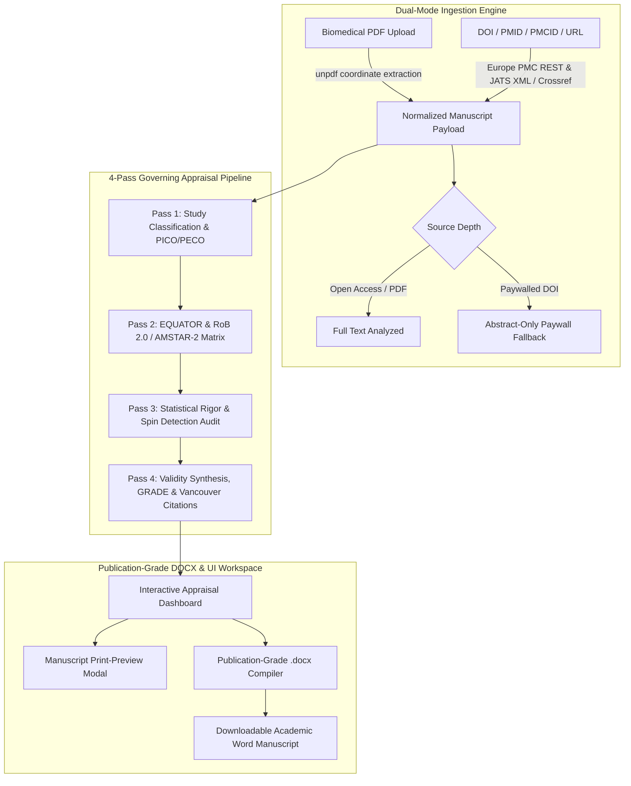

# AppraisAI

> **Automated Scientific Medical Paper Critical Appraisal & Publication-Ready Report Generation Platform**  
> Formatted according to **EQUATOR Network** reporting guidelines, **Cochrane Risk of Bias 2.0 (RoB 2)**, **AMSTAR-2**, **Oxford CEBM Levels of Evidence**, and the **GRADE Working Group** certainty framework.

---

## 🌟 Clinical Architecture & Workflow



---

## 🚀 Key Features

1. **Dual-Mode Paper Ingestion Engine:**
   - **Direct Upload:** Upload biomedical multi-column PDFs (NEJM, Lancet, JAMA, BMJ) with coordinate-aware layout reconstruction.
   - **Identifier Resolution:** Resolves any DOI (`10.xxxx/...`), PMID, PMCID, or article URL via **Europe PMC REST & JATS XML API** and **Crossref API**.
   - **Source Depth Watermarking:** Automatically flags `FULL_TEXT_PDF`, `FULL_TEXT_JATS_XML`, or `ABSTRACT_ONLY_FALLBACK` (if paywalled) to guard against hallucinated methodology.

2. **Multi-Stage Governing Critical Appraisal Engine:**
   - **Pass 1: Study Classification & PICO/PECO:** Detects RCTs, Systematic Reviews, Cohort Studies, Case-Control Studies, and Diagnostic Accuracy investigations; deconstructs PICO/PECO and writes a 4-part Executive Commentary Abstract.
   - **Pass 2: EQUATOR Reporting & Risk of Bias Matrix:** Enforces CONSORT 2010, PRISMA 2020, STROBE, or STARD 2015 checklists and evaluates Cochrane RoB 2.0, AMSTAR-2, or Newcastle-Ottawa Scale domains with exact text citations.
   - **Pass 3: Statistical Rigor & Spin Audit:** Audits sample size and power calculations, Intention-to-Treat (ITT) vs. Per-Protocol handling, multivariable confounding adjustments, subgroup multiplicity, and detects abstract/conclusion spin against primary trial results.
   - **Pass 4: Internal/External Validity & GRADE Synthesis:** Assigns Oxford CEBM Levels of Evidence (Level 1a to 5) and computes final GRADE Certainty of Evidence (High, Moderate, Low, Very Low) with explicit downgrading justifications.

3. **Publication-Ready `.docx` Compiler:**
   - Compiles an 8-section Microsoft Word manuscript typeset to publication specifications:
     - 1-inch margins, running headers with DOI and manuscript title, dynamic page numbers.
     - Vancouver bibliographic reference callout box.
     - Color-coded Cochrane RevMan Risk of Bias traffic-light summary strip.
     - Bordered PICO tables and effect estimate precision matrices.
     - Academic governance disclaimer signed with the clinician appraiser's name, affiliation, and ORCID.

4. **Multi-Provider & Zero-Friction Operation:**
   - Includes a built-in **Deterministic Evidence Synthesis Engine** that works immediately without any API key prerequisites.
   - Supports free-tier neural LLMs (**Google Gemini** `gemini-2.5-flash`, **Groq** `llama-3.3-70b-versatile`, and **OpenAI** `gpt-4o-mini`) via in-browser settings.

---

## 🛠️ Technology Stack

- **Framework:** Next.js 15 (App Router, Node.js runtime, TypeScript)
- **Styling:** Tailwind CSS with AIMed/Sysrevai medical teal palette
- **Document Parsers:** `unpdf` (server-safe Node.js PDF parsing), Europe PMC REST API, Crossref API, `fast-xml-parser`
- **Document Generation:** `docx` (npm) with programmatic table XML shading and styles
- **State Management:** Zustand with client-side persistence

---

## 💻 Local Development

```bash
# Clone the repository
git clone https://github.com/roroleaks/AppraisAI.git
cd AppraisAI

# Install dependencies
npm install

# Run development server
npm run dev
```

Open [http://localhost:3000](http://localhost:3000) in your browser.

---

## 👨‍⚕️ Author & Clinical Methodology

**Dr. Raouf Roshdy, MD**  
*Department of Clinical Epidemiology & Evidence-Based Medicine*  
ORCID: [0000-0002-1825-0097](https://orcid.org/0000-0002-1825-0097)

---

## 📄 License

MIT License © 2026 Dr. Raouf Roshdy. All rights reserved.
